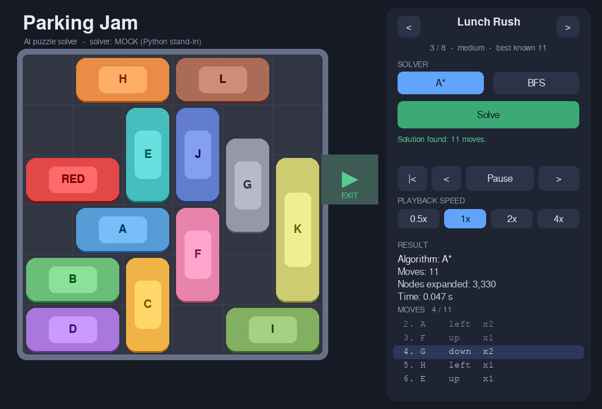

# Parking Jam - Frontend (Python + Pygame)

Draws the board, asks the connector for a solution and replays the moves step by
step. **No solving logic lives here** - all search (BFS, A*) is in Prolog.



## Run it

```bash
pip install pygame
python main.py                 # uses connector.py if it exists, else the mock
python main.py --mock          # force the mock connector
python main.py puzzles/03_lunch_rush.json   # open one puzzle file
```

Until the real connector exists, the window runs on `mock_connector.py`, a
Python stand-in with the same contract. The top-left of the window shows which
one is active (`MOCK (Python stand-in)` or `Prolog (pyswip)`).

| Key | Action | Key | Action |
|---|---|---|---|
| `S` / `Enter` | Solve | `Space` | Play / pause |
| `1` / `2` | Solver: A* / BFS | `Left` / `Right` | Step back / forward |
| `N` / `P` | Next / previous puzzle | `R` | Reset to start |

Results are cached per puzzle and solver, so you can solve with A*, solve with
BFS, then flip between them to compare moves, nodes expanded and time.

## Files

| File | Owner | What it is |
|---|---|---|
| `main.py` | frontend | Entry point, picks the connector |
| `app.py` | frontend | Pygame window, animation, solver worker thread |
| `board.py` | frontend | Board model, move validation, puzzle loading (no search) |
| `puzzles/*.json` | frontend | Test puzzles, easy to hard, plus one unsolvable |
| `mock_connector.py` | temporary | Stand-in for the real connector. Delete when `connector.py` works |
| `connector.py` | **connector teammate** | pyswip bridge. Does not exist yet |
| `tests/` | frontend | `python tests/test_logic.py`, `python tests/test_app_headless.py` |

## The contract (connector <-> frontend)

The connector must provide **one function** in `connector.py`:

```python
def solve(puzzle: dict, algorithm: str = "astar") -> dict
```

`algorithm` is `"astar"` or `"bfs"`.

### Puzzle (input)

```python
{
  "name": "Lunch Rush", "difficulty": "medium", "optimal_moves": 11,   # metadata, ignore
  "size": 6,
  "exit": {"side": "right", "row": 2},      # top/bottom exits use "col" instead of "row"
  "target": "red",
  "cars": [
    {"id": "red", "orient": "h", "row": 2, "col": 0, "length": 2},
    {"id": "A",   "orient": "v", "row": 0, "col": 2, "length": 3}
  ]
}
```

Rows and columns are 0-indexed. Row 0 is the top and column 0 is the left.
`orient` is `"h"` or `"v"`. The target car is always in the exit lane.

### Result (output) - plain Python dict, always one of:

```python
{"status": "solved",
 "moves": [{"car": "A", "direction": "down", "steps": 2}, ...],   # up/down/left/right
 "stats": {"num_moves": 11, "nodes_expanded": 3330, "time_sec": 0.047}}

{"status": "unsolvable"}
{"status": "timeout"}
{"status": "error", "message": "human readable reason"}
```

**Move counting rule (important for the Prolog side):** sliding a car several
cells in one direction is **one move** (`steps` = how many cells). The
`optimal_moves` value in each puzzle file uses this rule, so BFS and A* must too.
Otherwise the cross-check against `optimal_moves` will not match.

The frontend validates every move it receives. If Prolog returns an illegal
move, the window shows exactly which move and why (e.g. `Move 4: car G is
blocked by K`). If the solution is legal but longer than the puzzle's
`optimal_moves`, it shows a warning. This catches bad A* heuristics quickly.

## Notes for the connector teammate (pyswip)

1. **Create the `Prolog()` engine lazily inside `solve()`, not at import time.**
   pyswip's engine belongs to the thread that created it. The frontend calls
   `solve()` from one dedicated worker thread so the window stays responsive,
   so the engine must be created on that thread on the first call.
   ```python
   _prolog = None
   def solve(puzzle, algorithm="astar"):
       global _prolog
       if _prolog is None:
           from pyswip import Prolog
           _prolog = Prolog()
           _prolog.consult("solver.pl")
       ...
   ```
2. Run queries with `list(prolog.query(q, maxresult=1))`. A half-consumed query
   generator can break later queries.
3. Prolog compound terms like `move(a, down, 2)` come back as awkward `Functor`
   objects. Easiest: have Prolog return moves as lists, `[a, down, 2]`, and
   convert them to dicts in Python. Atoms may arrive as `str` or `Atom`, so wrap
   them with `str(...)`.
4. pyswip cannot cancel a running query. To support `"timeout"`, wrap the Prolog
   goal in `call_with_time_limit/2` (`library(time)`) and map the exception to
   `{"status": "timeout"}`.
5. Never raise from `solve()` for expected cases. Return the status dicts above.
   (Unexpected exceptions are caught by the frontend and shown as an error.)
6. Install SWI-Prolog itself (not just `pip install pyswip`) and make sure its
   32/64-bit build matches Python's.

## Adding puzzles

Drop a `.json` file in `puzzles/` using the format above. Invalid files are
skipped with a message (overlapping cars, car outside the board, target not in
the exit lane...). Add `"optimal_moves": N` to enable the shortest-solution check.
The included puzzles' `optimal_moves` were computed with an exhaustive BFS.

## Handoff checklist

- [ ] `connector.py` written; `python main.py` shows `Prolog (pyswip)` in the header
- [ ] BFS and A* both return `optimal_moves` on every solvable puzzle
- [ ] `Locked Column` returns `unsolvable`
- [ ] Delete `mock_connector.py` once the real connector is trusted
- [ ] Comparison table (moves / nodes / time per algorithm) for the report: solve each puzzle with both algorithms and read the RESULT panel
